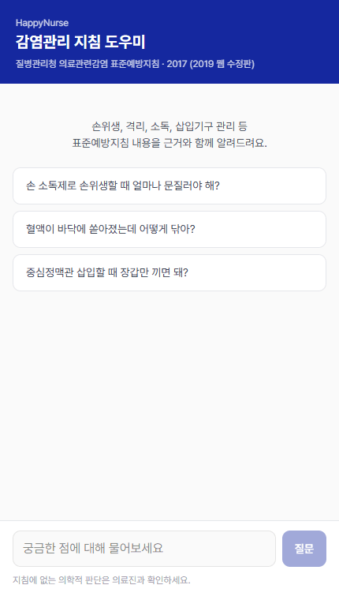
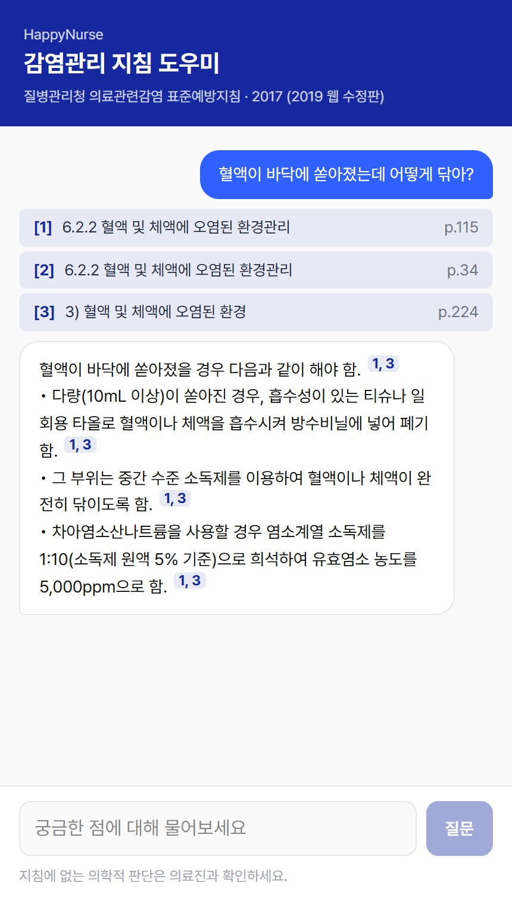

# HappyNurse 감염관리 지침 도우미

병동 간호사가 감염관리 지침을 말로 물어보면, 질병관리청 「의료관련감염 표준예방지침」에서 근거를 찾아 출처와 함께 답하는 RAG 서비스입니다.
병원 내부망에서도 쓸 수 있도록 임베딩, 리랭커, 답변 모델을 모두 로컬 GPU에서 돌립니다.

 

## 구성

```
[웹 · 앱]  ──POST /ask/stream (SSE)──▶  [rag-service · FastAPI]
                                           │
             ┌─────────────────────────────┼──────────────────────────────┐
             ▼                             ▼                              ▼
   임베딩 검색 20개 (bge-m3)      키워드 검색 20개 (BM25)          문서 원본 (PDF 323쪽)
             └──────────────┬──────────────┘                              │
                            ▼                                    parse → chunk → index
              리랭커 재채점 (bge-reranker-v2-m3)                  (단계마다 pytest 검사)
                            │
              1등 점수 < 0.2 → 거절 (LLM 호출 안 함)
                            │
                            ▼
                 답변 생성 (gemma3:4b, Ollama)
                            │
              출처 → 답 조각 → done 순서로 스트리밍
```

- **rag-service** (Python): FastAPI, Chroma, Ollama, sentence-transformers
- **web** (TypeScript): Next.js 16, React 19, Tailwind v4

## 데이터 파이프라인

| 단계        | 파일       | 하는 일                                                 | 검사 (`test_*.py`)                            |
| ----------- | ---------- | ------------------------------------------------------- | --------------------------------------------- |
| 범위 정하기 | `toc.py`   | PDF 장 목록과 쪽 범위 출력                              | 답변 근거에서 뺄 장을 결정                    |
| 파싱        | `parse.py` | 쪽 단위 마크다운 변환, 머리말·쪽 번호 제거              | 표 구조, 반복 줄, 쪽 번호 잔여                |
| 청킹        | `chunk.py` | 제목 경로 기준으로 자르고 짧은 조각은 합침              | 길이, 범위 밖 내용, 문헌 목록 잡음, 최신 여부 |
| 색인        | `index.py` | bge-m3 임베딩을 Chroma에 저장, 같은 문서의 옛 판은 교체 | 개수, 차원, 자기 검색                         |

- 참고문헌(p.151–160)과 지침 개발 과정(p.271–323), 장마다 끝에 붙은 참고지침서를 근거 범위에서 뺐습니다. 청크가 749개에서 497개로 줄었습니다.
- PDF 파서가 권고 문장을 제목으로 잘못 잡는 경우(권고등급 `(IB)`로 끝나는 줄)를 본문으로 되돌리고, 그 자리에서 청크를 나눠 권고문과 설명이 한 청크에 들어가게 했습니다.
- 테스트는 문서 내용을 출력하지 않고 숫자와 통과 여부만 출력합니다.

## 검색과 답변

- **후보 모으기**: 임베딩 검색은 뜻이 비슷한 청크를, 키워드 검색(BM25, 두 글자 단위)은 드문 단어가 겹치는 청크를 각각 20개씩 가져옵니다.
- **리랭커**: 질문과 후보를 한 쌍씩 같이 읽고 0~1점으로 다시 채점해 상위 3개를 고릅니다.
- **거절**: 1등 점수가 0.2보다 낮으면 LLM을 부르지 않고 "관련 지침을 찾지 못했습니다"로 답합니다.
- **답변 형식**: 결론을 먼저 말하고 할 일을 짧게 정리합니다. 숫자, 농도, 대상은 근거 그대로 쓰고 조항 번호와 참고문헌 번호는 쓰지 않도록 프롬프트에 예시 3개를 넣었습니다.
- **코드로 보장하는 것**: 프롬프트로 시켜도 경량화 모델이 지키지 못한 형식은 코드로 처리했습니다. 화면에서는 출처 범위 밖 번호를 숨깁니다.

## 평가

`eval_set.json`에 질문 16개를 두고 `eval.py`로 잽니다.

- **질문 만들기**: 로컬 LLM(`gen_questions.py`)으로 청크마다 현장 말투 질문 초안을 만들고, 사람이 원문과 대조해 고르고 고쳤습니다. 초안 20개 중 문서에 답이 없거나 문헌 목록에서 나온 질문 5개를 빼거나 거절 질문으로 바꿨습니다. 같은 권고가 요약, 본문, 부록에 반복되는 문서라 정답 쪽은 여러 곳을 함께 적었습니다.
- **검색**: hit@3(정답 쪽이 상위 3개 안에 있는 비율), MRR(1등 1점, 2등 0.5점, 3등 0.33점의 평균)
- **거절**: 문서에 없는 질문을 거절했는가, 근거가 있는데 거절했는가, 근거 없이 답했는가
- **답 품질**: 답변 모델과 다른 모델(qwen3:4b)이 모범답안과 비교해 정확/부분/틀림으로 채점합니다. 채점기도 `test_judge.py`로 먼저 검사합니다.
- **응답 시간**: 답변을 모두 받은 뒤 채점합니다. 모델을 번갈아 GPU에 올리면 시간이 섞이기 때문입니다.

### 개선 과정

| 단계 | hit@3 | MRR  | 답 정확 | 바꾼 것                                                   |
| ---- | ----- | ---- | ------- | --------------------------------------------------------- |
| 1    | 0.59  | 0.41 | -       | 첫 측정 (질문 초안 20개, 청크 749개)                      |
| 2    | 0.91  | 0.71 | -       | 질문 세트 검수, 근거 범위 정리                            |
| 3    | 0.92  | 0.72 | -       | 권고문 청크 경계 수정                                     |
| 4    | 1.00  | 0.81 | 7/12    | 키워드 후보 + 리랭커 + 점수 기준 거절                     |
| 5    | 1.00  | 0.86 | 10/12   | 답변 형식 프롬프트, 정답 쪽과 모범답안을 원문과 다시 대조 |

### 효과가 없어서 되돌린 것

- **키워드 검색 순위를 섞기(RRF)**: 세탁물 질문의 정답 순위가 14위에서 20위로 오히려 내려갔습니다. 질문 속 "보호구", "착용"이 키워드로도 보호구 청크에 몰렸기 때문입니다. 키워드 검색은 후보로만 쓰고 판정은 리랭커에 맡기는 방식으로 바꿨습니다.
- **리랭커만 넣기**: 검색은 좋아졌지만 문서에 없는 질문 하나에 답을 지어냈습니다. 리랭커 점수로 거절하는 기준을 함께 넣었습니다.
- **질문마다 짧은 지시 붙이기**: "네/아니요로 시작하라"는 지시가 오히려 결론을 잘못 고르게 해서 답 정확이 8/12에서 7/12로 내려갔습니다. 형식은 코드로 처리했습니다.
- **더 큰 답변 모델(qwen3:4b)**: 거절 실수는 없었지만 질문당 29초가 걸려 쓰지 않았습니다.

## 한계

- **작은 모델의 바꿔 쓰기**: 4B 모델이 문장을 쉽게 바꾸다가 조건을 빼는 경우가 있습니다(예: "접촉주의 격리 환자라면"을 빼고 항상 보호구를 착용하라고 답함). 화면에 근거 카드를 함께 보여 주는 이유입니다.
- **모호한 질문**: "이 바이알 이상하면?"처럼 정보가 부족한 질문은 점수 기준에 걸려 거절됩니다. 되묻는 기능이 필요합니다.
- **작은 평가 세트**: 16문항이라 한 문항이 8%포인트를 움직이고, LLM 채점도 경계선에서 판정이 바뀝니다. 거절 기준 0.2도 질문이 늘면 다시 맞춰야 합니다.
- **대화 맥락 없음**: 질문마다 따로 검색합니다. "그럼 장갑은?" 같은 이어지는 질문은 처리하지 않습니다.
- **문서 판**: 2017년 지침(2019 웹 수정판) 기준입니다. 새 판이 나오면 `doc_id`가 같은 옛 청크를 지우고 다시 넣습니다.

## 폴더

```
rag-service/
  toc.py parse.py chunk.py index.py   데이터 파이프라인
  ask.py                              검색, 리랭크, 거절, 답변 생성
  api.py                              FastAPI (/ask, /ask/stream)
  eval.py eval_set.json               평가
  gen_questions.py                    평가 질문 초안 생성 (로컬 LLM)
  test_*.py conftest.py pytest.ini    단계별 검사
web/
  src/app/page.tsx                    채팅 화면
  src/lib/sse.ts                      POST SSE 클라이언트
```
